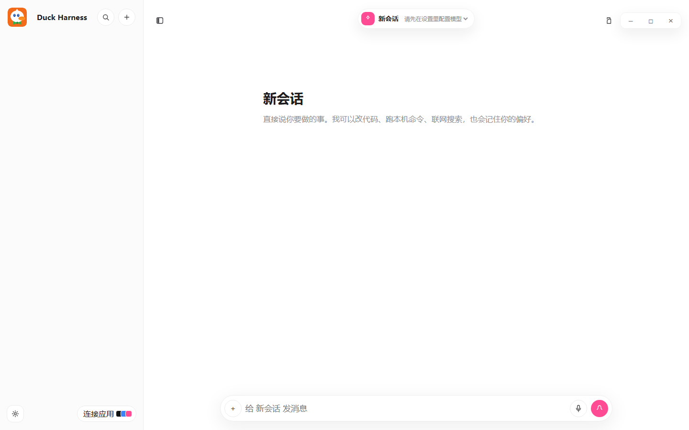
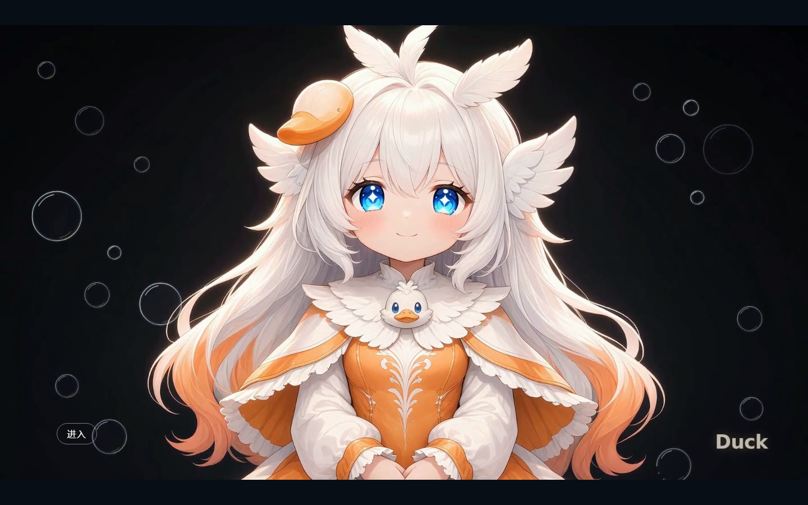

<p align="center">
  
</p>

<h1 align="center">duck-harness</h1>

<p align="center">
  跑在你自己电脑上的编程 Agent。<br/>
  它能读代码、改文件、跑命令，也能把几只 Agent 拉进同一个群里交接。
</p>

<p align="center">
  
</p>

<p align="center">
  <sub>工作区里原来没有这两个文件。它写好 <code>stats.py</code> 和 <code>test_stats.py</code>，<code>python -m unittest test_stats</code> 的 3 个测试全部通过。</sub>
</p>

网页和桌面用的是同一套界面、同一份会话。后端是 Python，会话、记忆、任务和用量记在本机 SQLite 里。模型可以接 DeepSeek，也可以接本机 Ollama。

## 演示

打开网页或桌面时，先播一段开场。播完进入登录。登录后会记住这次登录，下次打开直接进入，不再播放动画。退出之后才会重新看到开场和登录。

<p align="center">
  
</p>

下面的任务都是本机真实跑出来的，没有摆拍。

**几只 Agent 在一个群里把事情做完。** 用户 `@项目经理` 做班次加班费。项目经理拆开任务交给实现工程师，验收工程师独立跑过测试，再交回项目经理。

<p align="center">
  
</p>

**新会话先问两轮，再开始干活。** 这只「技术架构师」问了做什么、做到哪一层，问完就停住，等你把具体的事发过来。中途直接打字，提问也会结束。

<p align="center">
  
</p>

**每只 Agent 是同一只往右上斜的鸭子。** 圆头、蓝眼睛、橙嘴，和窗口上的图标是一套，能看到头的侧面。创建时从八只里挑一只，颜色每次打开随机取一个。群聊用好几只叠在一起，好和单个会话分开。已经建好的会话仍用原来的图标。

<p align="center">
  
</p>

## 能做什么

- **工具循环。** 模型决定下一步，后端在本机执行，结果写回对话，再继续问模型，直到它给出正文，或你停掉这一轮。
- **群聊。** `@名字` 指定下一个开口的成员。成员可以交接，也可以私聊。每个成员仍是自己的会话。新建群聊时可以另选一组图标和颜色。
- **启动动画。** 还没登录时，打开网页或桌面先播开场，播完进入登录。
- **账号。** 注册和登录之后，会话、上传的文件、设置和密钥按用户分开。登录状态会记住，退出才需要重新登录。
- **密钥。** 写在设置里的 DeepSeek 密钥入库前加密，调用模型时再解密。加密钥匙在本机 `data/secret.key`，也可以用环境变量 `HARNESS_SECRET_KEY`。不要把这把钥匙和数据库备份放在一起交给别人。
- **开场提问。** 新建的普通会话先问最多两轮选择题。问清楚之后，你把要做的事发过来。
- **本机操作。** 读改文本、PDF、Word 和 Jupyter，搜索文件，在 PowerShell 里执行命令，也能把长命令放到后台。
- **联网。** 搜索和抓取网页，再把需要的部分放进上下文。
- **公式。** 对话里的数学公式会直接渲染出来。
- **记得住。** 长期记忆、当前会话的任务，以及工作区里的 `AGENTS.md` / `HARNESS.md`，会在下一轮继续生效。
- **权限。** `auto` 直接执行，`plan` 只读并写计划，`ask` 在改文件或跑命令前等你点允许，`edits` 改文件免问、命令仍要确认，`dontAsk` 把需要确认的操作直接拒绝。密钥文件和少数破坏性命令即使在自动模式下也会被拦住。
- **删会话时收干净。** 这次上传的副本，和只属于这次对话的撤销记录，会跟着会话一起删掉。工作区里的项目文件和长期记忆还留着。
- **扩展。** 技能、MCP、定时任务，以及 explore / plan / general 子代理。

## 快速开始

需要改代码时再安装 Python 3.11+ 和 Node.js。只是打开软件的话，双击根目录的 `Duck Harness.exe` 即可，不用安装 Python、Node，也不用执行 `npm install`。它自带界面和服务。关掉窗口后，这次由它启动的服务会一起退出；本机命令和 MCP 子进程也会跟着停掉。如果 8787 端口上已经有一个服务，窗口会连上现成的，关掉窗口不会结束那个服务。

数据库用 Python 自带的 SQLite，启动时自动建表，文件在 `data/harness.sqlite`。这份数据库、`data/workspaces/` 里的账号目录、`data/uploads/` 里的会话附件和 `data/secret.key` 都不进仓库。服务器拿到代码后是空库，注册时按用户编号重新生成工作区。窗口能打开，是因为 Windows 自带 Edge WebView2。软件里如果要执行 Python 或 npm 命令，那台电脑仍要另外安装对应工具。

```bat
cd backend
copy .env.example .env
pip install -r requirements.txt
cd ..\frontend
npm install
npm run build
cd ..
启动网页.bat
```

浏览器会打开 http://127.0.0.1:8787 。先播放启动动画，再注册或登录。登录后会记住状态，下次打开直接进入，不再播放动画。桌面窗口用 `启动桌面.bat`。服务还没起来时，它会自己启动同一个后端。两个入口可以同时开。

DeepSeek 密钥写在界面的设置里，也可以写在 `backend/.env` 的 `DEEPSEEK_API_KEY`。设置里保存的密钥会加密后再入库。`.env` 和 `data/secret.key` 已经在 `.gitignore` 里，不要提交。

本机如果用 Anaconda 的 `agent` 环境，两个启动脚本会优先找这个环境里的 Python。

Ubuntu 服务器用 Docker 部署，步骤在 `docker/README.md`。服务器上不用安装 MySQL。

## 配置

`backend/.env.example` 里是本地默认值：

| 变量 | 作用 |
| --- | --- |
| `DATABASE_URL` | 留空即可。数据写在 `data/harness.sqlite` |
| `DEEPSEEK_API_KEY` | DeepSeek 密钥。留空时可以改在界面里填写。界面里保存的密钥会加密入库 |
| `HARNESS_SECRET_KEY` | 可选。用来加密设置里的密钥。留空时自动写到 `data/secret.key` |
| `DEEPSEEK_BASE_URL` | 默认 `https://api.deepseek.com` |
| `OLLAMA_BASE_URL` | 默认 `http://127.0.0.1:11434` |
| `HARNESS_WORKSPACE` | 还没有账号时的兜底目录。登录后每个账号使用 `data/workspaces/用户编号` |

服务启动时会自己建表，并补上后来增加的字段。第一次打开是空的会话列表。只有把 `AUTO_SEED` 设为 `true` 时，才会放进一组示例会话。

### 可选：改用 MySQL

已经有 MySQL 时，可以把 `DATABASE_URL` 写成连接串。启动连得上就用 MySQL，连不上会自动回到 SQLite。建库可以执行 `mysql -u root -p < sql\init.sql`。不装 MySQL 也能完整使用。

## 目录

```text
backend/     FastAPI、工具循环、群聊、登录、权限和测试
frontend/    Vue 3 + Pinia 界面
desktop/     pywebview 桌面壳
docker/      Ubuntu 上的容器部署
sql/         可选的 MySQL 建库脚本
docs/        架构说明和界面图
```

更细的运行说明在 `docs/架构说明.md`。

## 开发

```bat
cd backend
python -m pytest -q
```

`backend/scripts/verify_live.py` 会真实请求 DeepSeek 和 Ollama。跑它之前要先配好密钥，并确认 Ollama 已经启动。

## 许可

[MIT](LICENSE)
